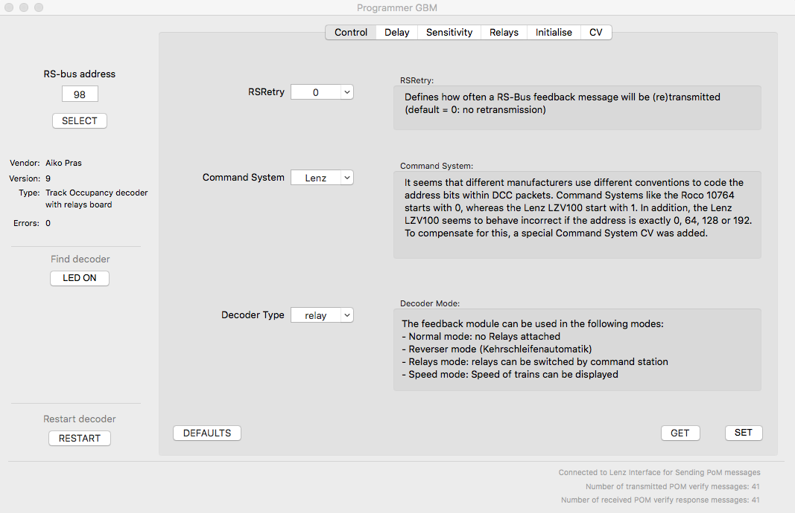
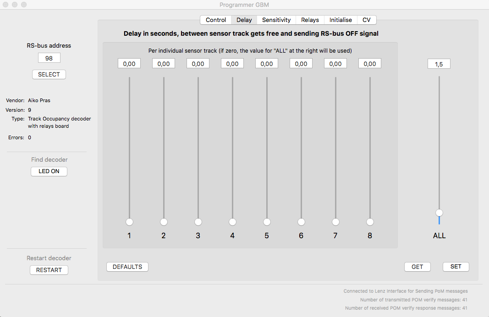
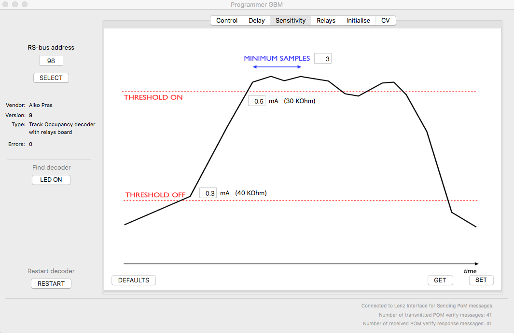
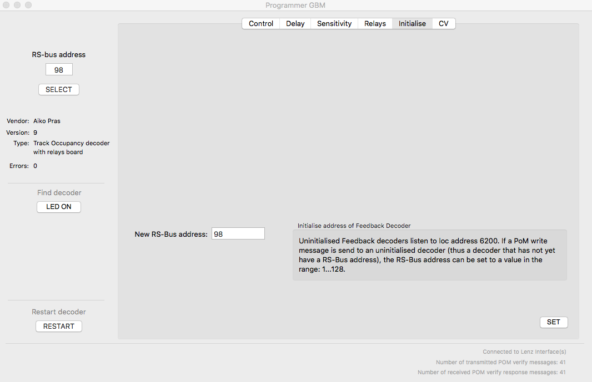
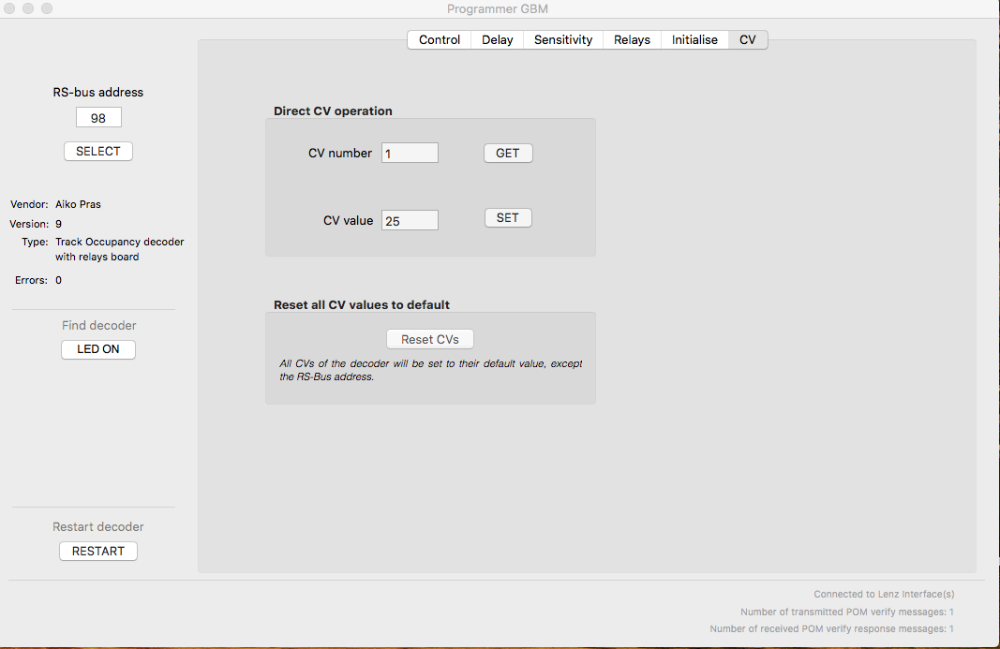
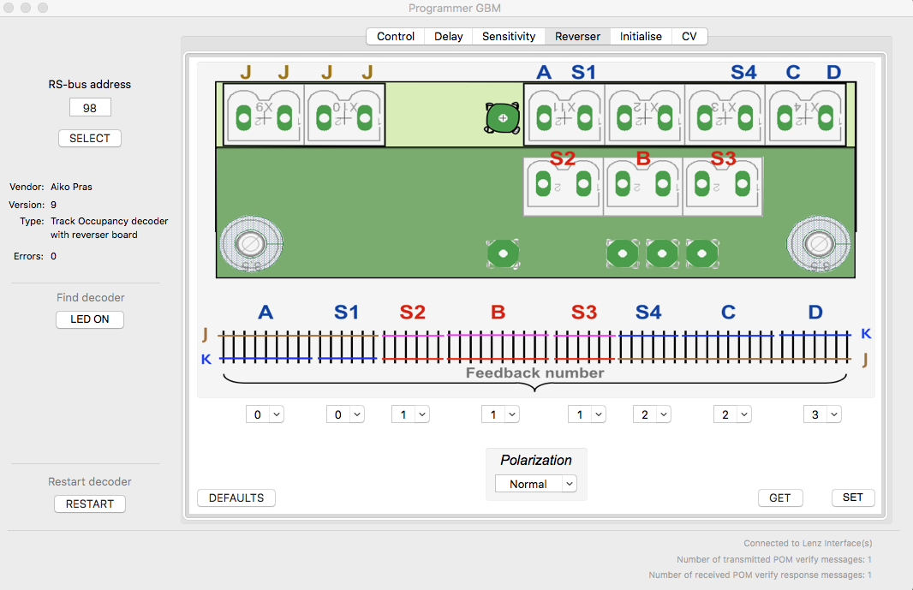
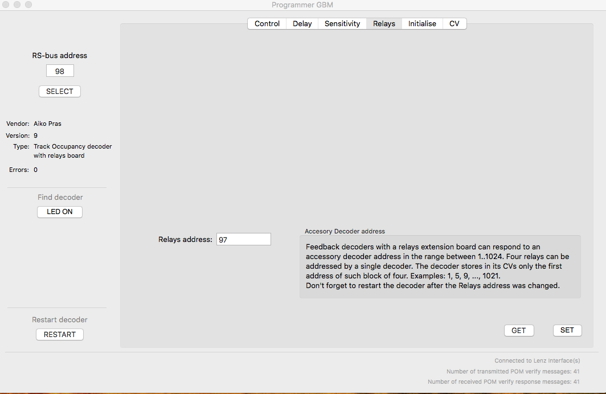
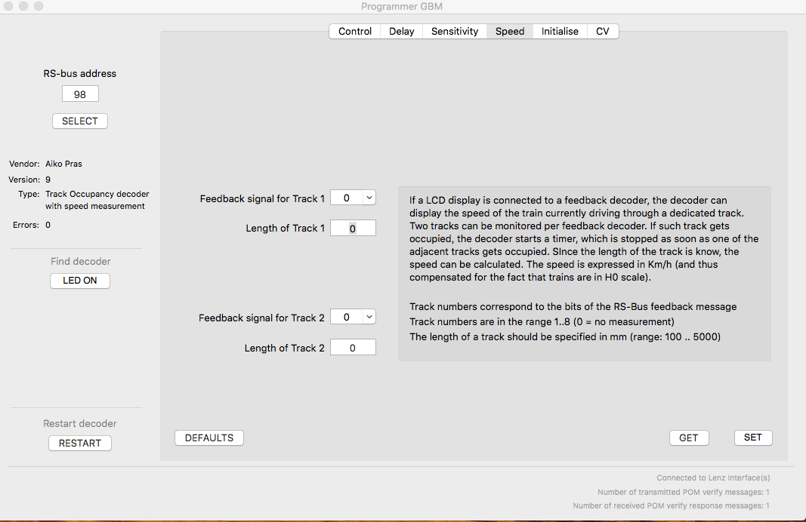
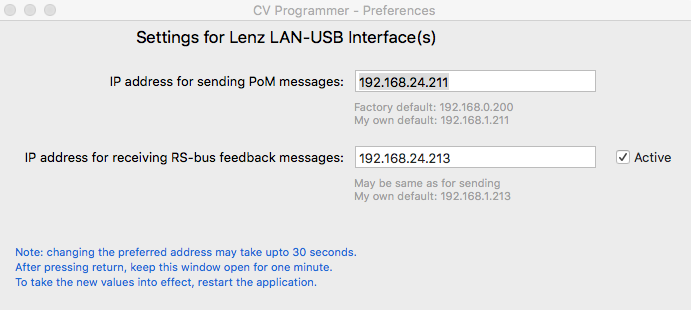

[🇬🇧 English](Manual.md) | [🇩🇪 Deutsch](Manual.de.md) | [🇳🇱 Nederlands](Manual.nl.md)

# Programmer-GBM-POM – Handbuch
Zurück zur [README](../README.de.md). Alle CVs sind in den Hilfeseiten des Programms beschrieben (Menü Help, Englisch).

## Hauptfenster ##
- **RS-bus address**: die Adresse des Decoders (1..128). Return oder SELECT liest alle CVs des Decoders.
- **Leeres Adressfeld**: SELECT sucht einen noch nicht initialisierten Decoder (RS-Bus-Adresse 0). Wird einer gefunden, meldet die Statuszeile dies und der Reiter Initialise wird gezeigt.
- **Vendor, Version, Type, Errors**: aus dem Decoder gelesene Angaben; Errors ist die Anzahl der DCC-Prüfsummenfehler.
- **LED ON**: die LED des Decoders blinkt, um ihn auf der Anlage zu finden. **RESTART** startet den Decoder neu.

Die meisten Reiter haben die Tasten **DEFAULTS** (zeigt die Standardwerte), **GET** (liest die Werte aus dem Decoder) und **SET** (schreibt die Werte in den Decoder). Eine rote SET-Taste bedeutet: Werte geändert, aber noch nicht geschrieben.

## Reiter für alle Decoder ##
**Control**: RS-Bus-Wiederholungen (RSRetry), die Lenz-Adresskorrektur (Command System) und der Decoder Type. Der Decoder Type bestimmt, ob der Reiter Reverser, Relays oder Speed gezeigt wird.

**Delay**: pro Eingang die Verzögerung, bevor ein besetztes Gleis als frei gemeldet wird (DelayIn1..8, in Schritten von 0,01 s). Eingänge mit Verzögerung 0 verwenden die Verzögerung von „All“ (Delay_off, in Schritten von 0,1 s).

**Sensitivity**: die Anzahl der Messungen (je 8 ms), die übereinstimmen müssen, bevor eine Änderung gemeldet wird (Min_Samples), und der Strom, oberhalb dessen ein Gleis besetzt und unterhalb dessen es wieder frei ist (in mA; der entsprechende Widerstand wird ebenfalls gezeigt). Der zweite Wert sollte kleiner als der erste sein.

**Initialise**: gibt einem noch nicht initialisierten Decoder seine RS-Bus-Adresse. Dies geht auch mit dem Taster auf dem Decoder.

**CV**: liest oder schreibt eine einzelne CV, oder setzt alle CVs auf ihre Standardwerte zurück. Dabei wird auch die RS-Bus-Adresse 0, der Decoder muss also erneut initialisiert werden.

## Decoder Type „reverser“ ##
**Reverser**: der RS-Bus-Eingang (1..8), der für die Gleise A..D und die Sensoren 1..4 gemeldet wird, und die Polarität des J&K-Anschlusses.

## Decoder Type „relay“ ##
**Relays**: die Zubehöradresse der Relais-Erweiterungsplatine (1..1024, oder 1..2048 bei Zentralen mit Software 3.8 oder neuer).

## Decoder Type „speed“ ##
**Speed**: die Eingänge (2..7; 0 = keiner) und die Längen (100..5000 mm) der beiden Messstrecken für die Geschwindigkeit.

## Einstellungen ##
Die IP-Adresse(n) der Lenz LAN/USB-Interfaces: eine zum Senden der PoM-Befehle, und eine (darf dieselbe sein) zum Empfangen der RS-Bus-Rückmeldungen. macOS: Preferences im Programmmenü; Windows und Linux: File → Preferences. Die neuen Werte werden beim nächsten Verbindungsaufbau verwendet.

Die Einstellungen werden gespeichert in:
- macOS: `~/Library/Preferences/AikoPras.Programmer-GBM-POM.plist`
- Windows: der Registry, `HKEY_CURRENT_USER\Software\Programmer GBM-POM\Settings`
- Linux: `~/.config/Programmer GBM-POM/Settings.conf`

## Logdatei ##
Die Windows- und Linux-Versionen schreiben Fehler, Warnungen und Verbindungsmeldungen der XpressNet-Verbindung(en) in `TMC-LogFile.txt` (ältere Logdateien: `TMC-LogFile-1..3.txt`):
- Windows: `%PUBLIC%\TMC-Logfiles` (meistens `C:\Users\Public\TMC-Logfiles`)
- Linux: `~/TMC-Logfiles`

Die macOS-Version schreibt keine Logdatei.
