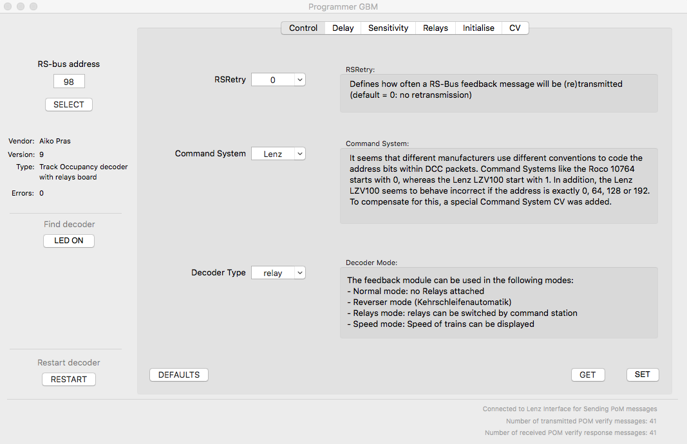
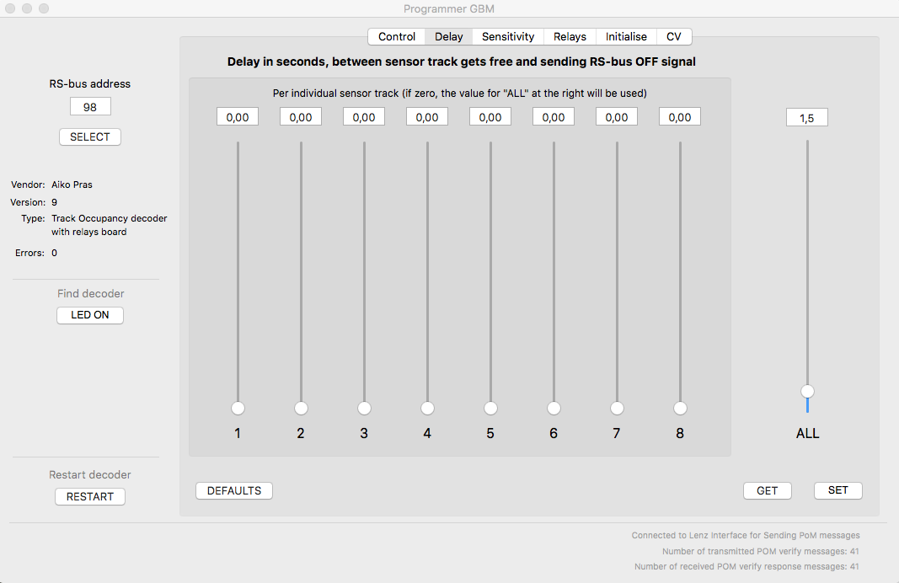
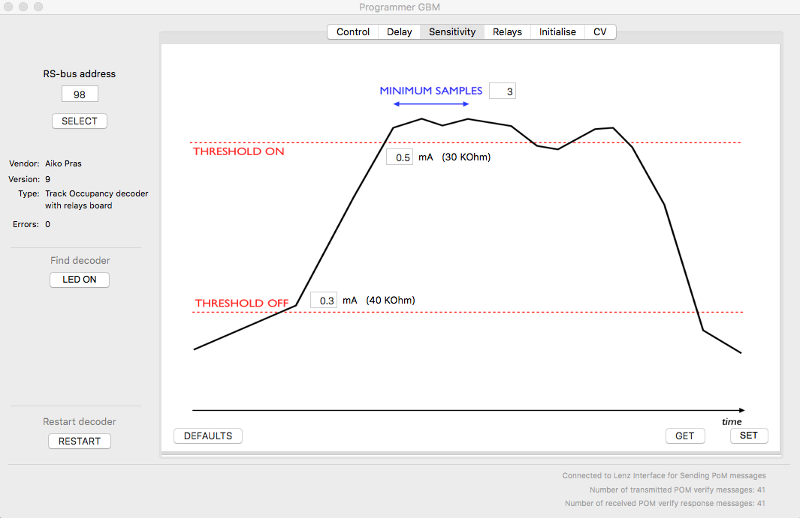
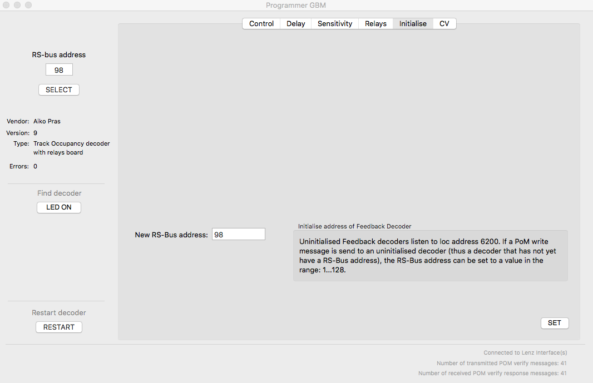
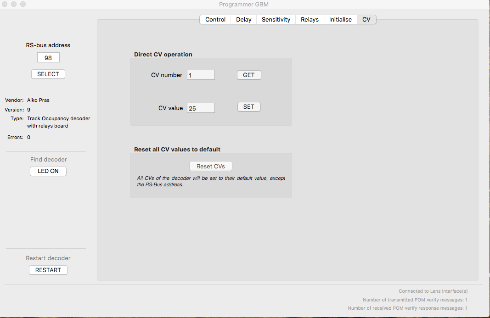
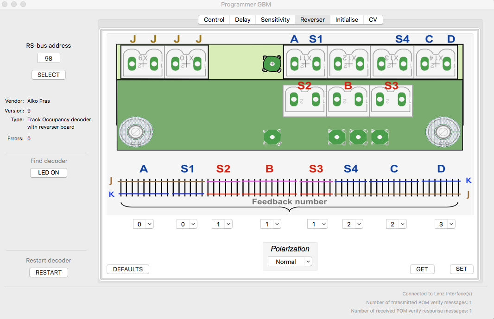
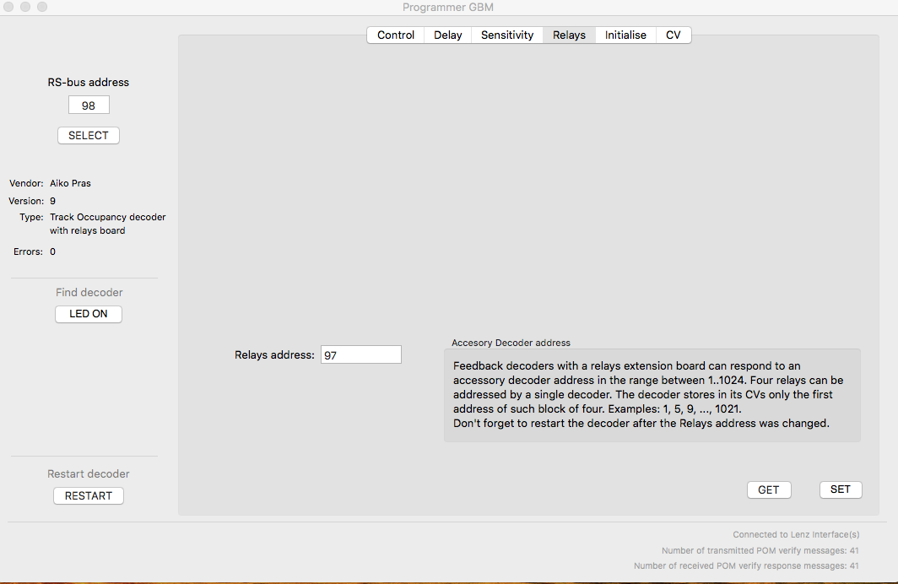
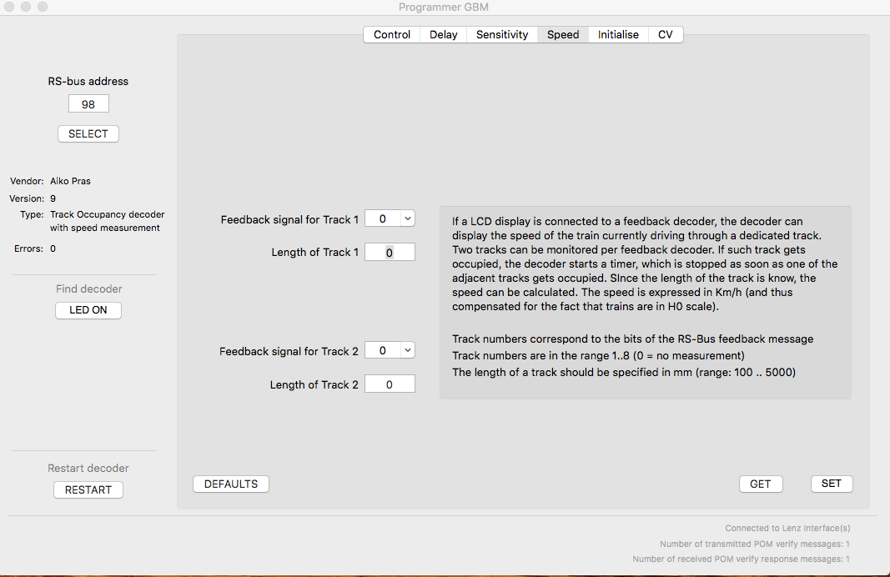
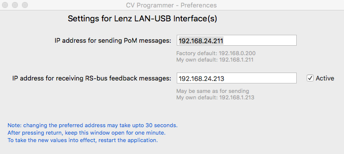

[🇬🇧 English](Manual.md) | [🇩🇪 Deutsch](Manual.de.md) | [🇳🇱 Nederlands](Manual.nl.md)

# Programmer-GBM-POM – Manual
Back to the [README](../README.md). All CVs are described in the help pages of the program (menu Help).

## Main window ##
- **RS-bus address**: the address of the decoder (1..128). Press Return or SELECT to read all CVs of the decoder.
- **Empty address field**: SELECT searches for a decoder that is not yet initialised (RS-Bus address 0). If one is found, the status line says so and the Initialise tab is shown.
- **Vendor, Version, Type, Errors**: information read from the decoder; Errors is the number of DCC checksum errors.
- **LED ON**: the LED of the decoder blinks, to find it on the layout. **RESTART** restarts the decoder.

Most tabs have the buttons **DEFAULTS** (shows the default values), **GET** (reads the values from the decoder) and **SET** (writes the values to the decoder). A red SET button means: values changed, but not yet written.

## Tabs for all decoders ##
**Control**: RS-Bus retransmissions (RSRetry), the Lenz address correction (Command System) and the Decoder Type. The Decoder Type determines whether the Reverser, Relays or Speed tab is shown.

**Delay**: per input the delay before an occupied track is reported free (DelayIn1..8, in steps of 0.01 s). Inputs with delay 0 use the delay of "All" (Delay_off, in steps of 0.1 s).

**Sensitivity**: the number of samples (8 ms each) that must agree before a change is reported (Min_Samples), and the current above which a track is occupied and below which it is free again (in mA; the corresponding resistance is shown as well). The second value should be lower than the first.

**Initialise**: gives a decoder that is not yet initialised its RS-Bus address. This can also be done with the push button on the decoder.

**CV**: reads or writes a single CV, or resets all CVs to their default values. A reset also sets the RS-Bus address to 0, so the decoder must be initialised again.

## Decoder Type "reverser" ##
**Reverser**: the RS-Bus input (1..8) that is reported for the tracks A..D and the sensors 1..4, and the polarization of the J&K connection.

## Decoder Type "relay" ##
**Relays**: the accessory address of the relays extension board (1..1024, or 1..2048 for command stations with software 3.8 or higher).

## Decoder Type "speed" ##
**Speed**: the inputs (2..7; 0 = none) and the lengths (100..5000 mm) of the two speed measurement tracks.

## Preferences ##
The IP address(es) of the Lenz LAN/USB interface(s): one for sending PoM messages, and one (may be the same) for receiving the RS-Bus feedback. macOS: Preferences in the program menu; Windows and Linux: File → Preferences. The new values are used the next time the program connects.

The preferences are stored in:
- macOS: `~/Library/Preferences/AikoPras.Programmer-GBM-POM.plist`
- Windows: the registry, `HKEY_CURRENT_USER\Software\Programmer GBM-POM\Settings`
- Linux: `~/.config/Programmer GBM-POM/Settings.conf`

## Logfile ##
The Windows and Linux versions write errors, warnings and connection messages of the XpressNet connection(s) to `TMC-LogFile.txt` (older logfiles: `TMC-LogFile-1..3.txt`):
- Windows: `%PUBLIC%\TMC-Logfiles` (usually `C:\Users\Public\TMC-Logfiles`)
- Linux: `~/TMC-Logfiles`

The macOS version writes no logfile.
