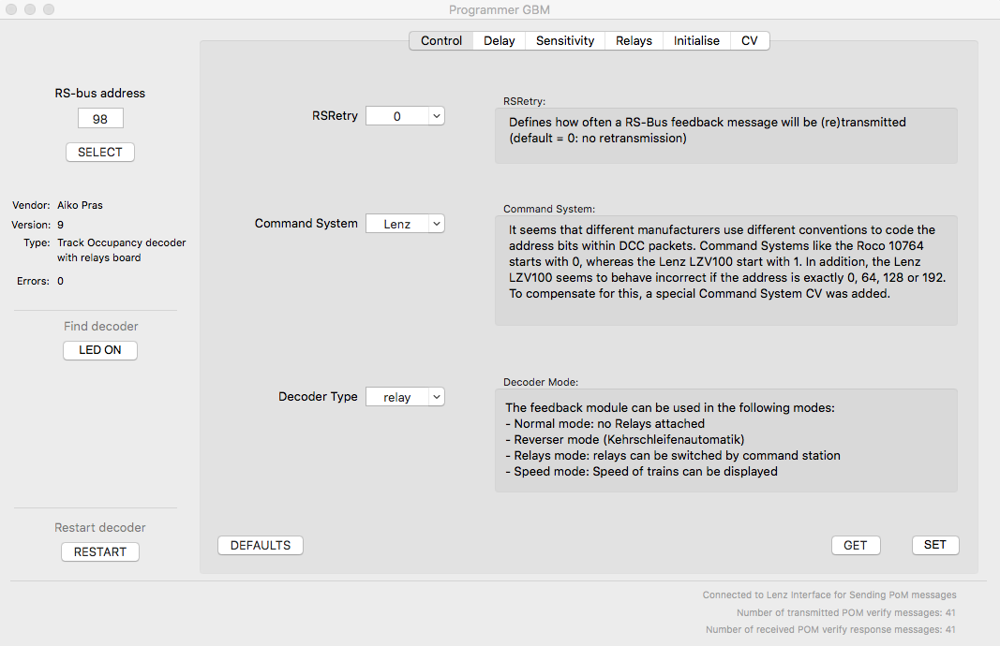
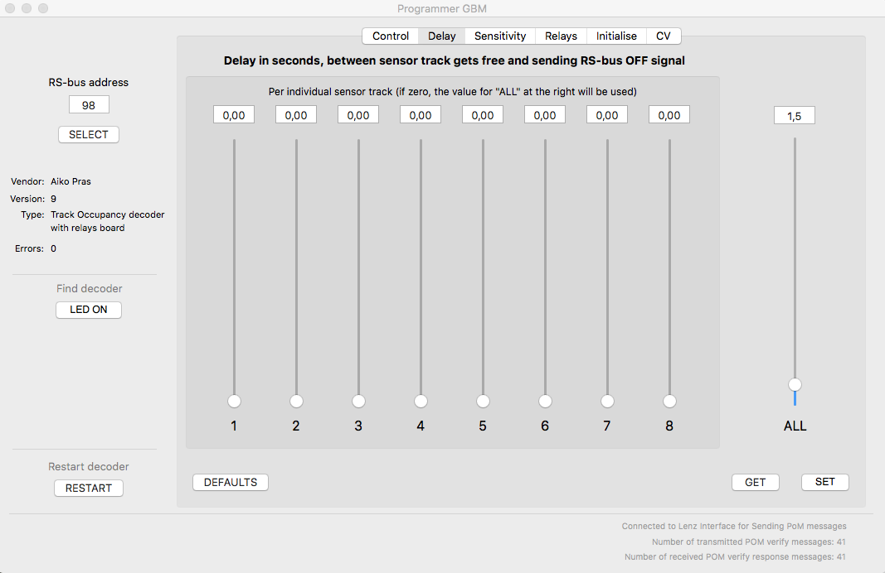
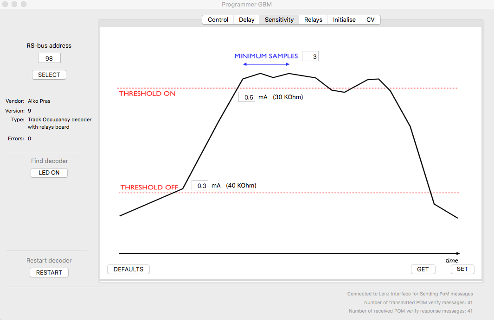
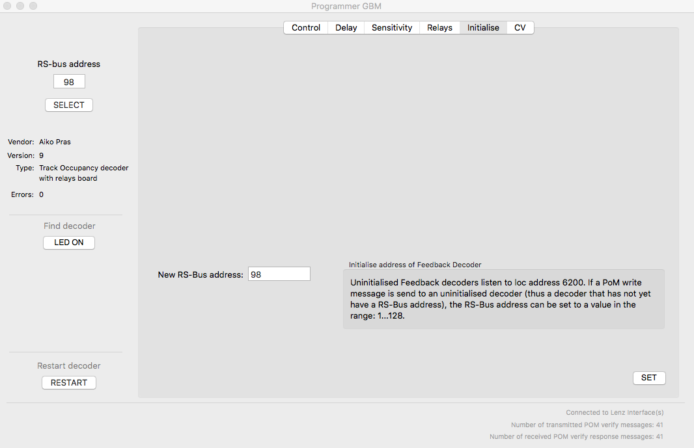
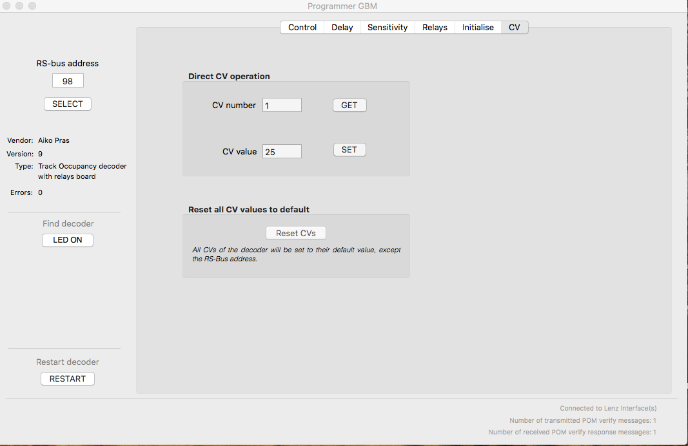
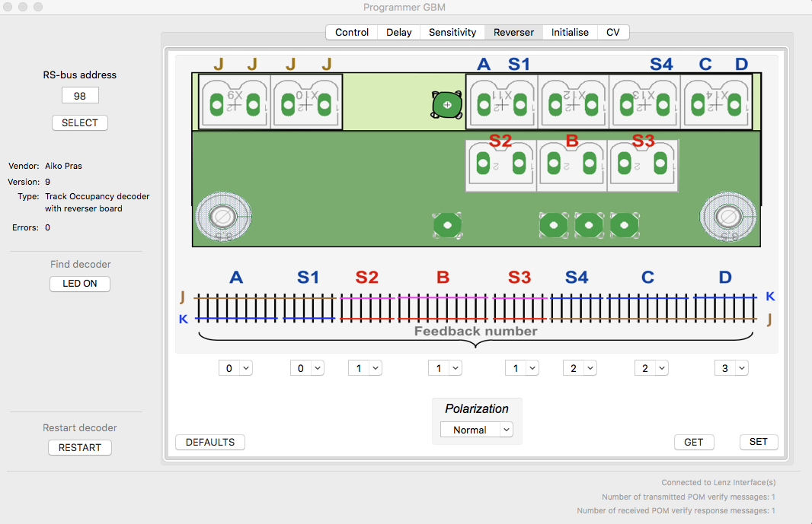
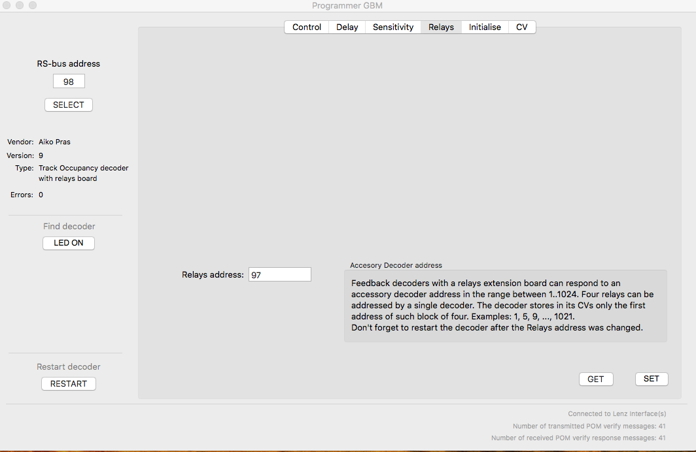
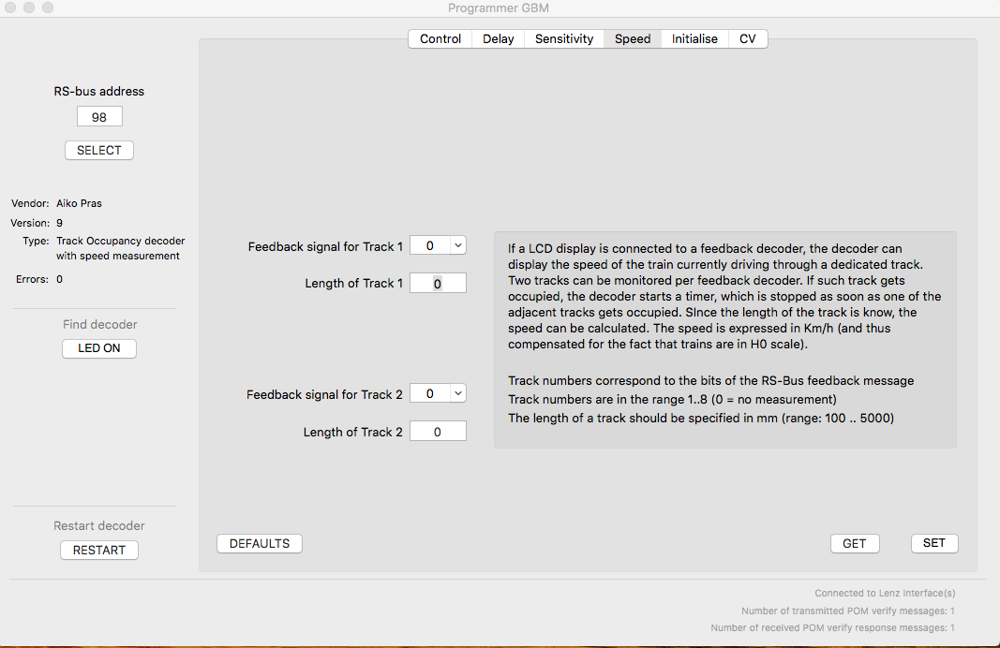
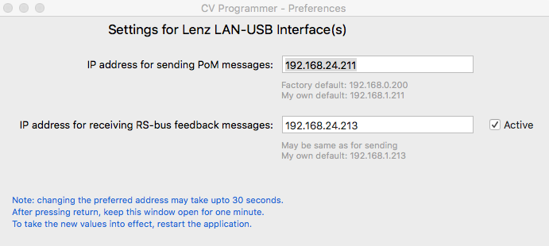

[🇬🇧 English](Manual.md) | [🇩🇪 Deutsch](Manual.de.md) | [🇳🇱 Nederlands](Manual.nl.md)

# Programmer-GBM-POM – Handleiding
Terug naar de [README](../README.nl.md). Alle CV's staan beschreven in de helppagina's van het programma (menu Help, Engels).

## Hoofdscherm ##
- **RS-bus address**: het adres van de decoder (1..128). Return of SELECT leest alle CV's van de decoder.
- **Leeg adresveld**: SELECT zoekt een decoder die nog niet geïnitialiseerd is (RS-Bus-adres 0). Wordt er een gevonden, dan meldt de statusregel dat en wordt de tab Initialise getoond.
- **Vendor, Version, Type, Errors**: gegevens die uit de decoder gelezen zijn; Errors is het aantal DCC-checksumfouten.
- **LED ON**: de LED van de decoder knippert, om hem op de baan te vinden. **RESTART** herstart de decoder.

De meeste tabs hebben de knoppen **DEFAULTS** (toont de standaardwaarden), **GET** (leest de waarden uit de decoder) en **SET** (schrijft de waarden naar de decoder). Een rode SET-knop betekent: waarden gewijzigd, maar nog niet geschreven.

## Tabs voor alle decoders ##
**Control**: RS-Bus-herhalingen (RSRetry), de Lenz-adrescorrectie (Command System) en het Decoder Type. Het Decoder Type bepaalt of de tab Reverser, Relays of Speed wordt getoond.

**Delay**: per ingang de vertraging voordat een bezet spoor als vrij wordt gemeld (DelayIn1..8, in stappen van 0,01 s). Ingangen met vertraging 0 gebruiken de vertraging van "All" (Delay_off, in stappen van 0,1 s).

**Sensitivity**: het aantal metingen (elk 8 ms) dat gelijk moet zijn voordat een verandering wordt gemeld (Min_Samples), en de stroom waarboven een spoor bezet is en waaronder het weer vrij is (in mA; de bijbehorende weerstand wordt ook getoond). De tweede waarde moet lager zijn dan de eerste.

**Initialise**: geeft een nog niet geïnitialiseerde decoder zijn RS-Bus-adres. Dit kan ook met de drukknop op de decoder.

**CV**: leest of schrijft één CV, of zet alle CV's terug naar hun standaardwaarden. Daarbij wordt ook het RS-Bus-adres 0, dus de decoder moet daarna opnieuw geïnitialiseerd worden.

## Decoder Type "reverser" ##
**Reverser**: de RS-Bus-ingang (1..8) die gemeld wordt voor de sporen A..D en de sensoren 1..4, en de polariteit van de J&K-aansluiting.

## Decoder Type "relay" ##
**Relays**: het accessory-adres van de relais-uitbreidingsprint (1..1024, of 1..2048 bij centrales met software 3.8 of nieuwer).

## Decoder Type "speed" ##
**Speed**: de ingangen (2..7; 0 = geen) en de lengtes (100..5000 mm) van de twee meetsporen voor de snelheid.

## Voorkeuren ##
De IP-adres(sen) van de Lenz LAN/USB-interface(s): één voor het versturen van de PoM-berichten, en één (mag dezelfde zijn) voor het ontvangen van de RS-Bus-terugmeldingen. macOS: Preferences in het programmamenu; Windows en Linux: File → Preferences. De nieuwe waarden worden gebruikt bij de volgende verbinding.

De voorkeuren worden bewaard in:
- macOS: `~/Library/Preferences/AikoPras.Programmer-GBM-POM.plist`
- Windows: het register, `HKEY_CURRENT_USER\Software\Programmer GBM-POM\Settings`
- Linux: `~/.config/Programmer GBM-POM/Settings.conf`

## Logfile ##
De Windows- en Linux-versies schrijven fouten, waarschuwingen en verbindingsmeldingen van de XpressNet-verbinding(en) naar `TMC-LogFile.txt` (oudere logfiles: `TMC-LogFile-1..3.txt`):
- Windows: `%PUBLIC%\TMC-Logfiles` (meestal `C:\Users\Public\TMC-Logfiles`)
- Linux: `~/TMC-Logfiles`

De macOS-versie schrijft geen logfile.
