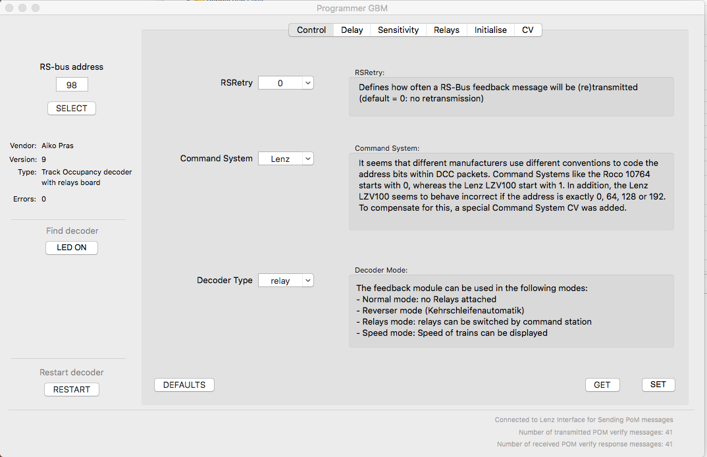

[🇬🇧 English](README.md) | [🇩🇪 Deutsch](README.de.md) | [🇳🇱 Nederlands](README.nl.md)

# Programmer-GBM-POM
Software zur Konfiguration des Belegtmelders (Rückmeldedecoders) mit RS-Bus-Rückmeldung: der Gleisbesetztmeldung (GBM).

Mit diesem Programm kann der [Belegtmelder (Rückmeldedecoder) / Gleisbesetztmelder](https://github.com/aikopras/OPENDECODER22GBM) eingestellt werden, indem seine CVs gelesen und geändert werden. Dieser Decoder sendet Rückmeldungen über den RS-Bus und kann, zum Einstellen, aber auch zum Schalten von Relais, auf DCC-Befehle hören. Da der Decoder den RS-Bus für die Rückmeldung verwendet, ist er vor allem für Anlagen mit LENZ-Zentralen (wie der LZV 100) interessant, die über ein LAN/USB-Interface (wie das 23151) angeschlossen sind.

## CV-Werte lesen ##
Zum Einstellen und Ändern der CVs des Decoders sendet das Programm PoM-Befehle (Programming on the Main). Da die XpressNet-Spezifikation PoM-Befehle nur für Lokdecoder vorsieht (nicht für Zubehör- oder Rückmeldedecoder), hört der Decoder als „Trick“ auf die Lokadresse <I>RS-Bus-Adresse + 6000</I>. Die angefragten CV-Werte werden über den RS-Bus zurückgemeldet: von neueren Decodern mit der Adresse 128, von älteren Decodern mit ihrer eigenen RS-Bus-Adresse. Da neuere Decoder die Adresse 128 für ihre PoM-Rückmeldungen teilen, müssen die Decoder einzeln eingestellt werden.

Das Programm kommuniziert mit der LENZ-Zentrale über das LAN/USB-Interface (23151). Werden für DCC-Befehle und RS-Bus-Rückmeldungen verschiedene Zentralen verwendet, können zwei LAN/USB-Interfaces benutzt werden.

## Startfenster ##
Das Programm startet mit einem Fenster, in dem die RS-Bus-Adresse eingegeben wird und einige Angaben zu diesem Decoder gezeigt werden. Die Reiter des Programms werden im [Handbuch](Manual/Manual.de.md) näher erklärt.

## Download ##
| Version | Läuft auf | Programm und Installation | Quellcode und Übersetzen |
|---|---|---|---|
| macOS | macOS 12 oder neuer, Apple Silicon und Intel | [Compiled-Applications/macOS](Compiled-Applications/macOS/README.md) | [src/Xcode](src/Xcode/README.md) (Objective-C) |
| Windows | Windows 10 / 11 (64 Bit), Intel / AMD und ARM | [Compiled-Applications/Windows](Compiled-Applications/Windows/README.md) | [src/Qt](src/Qt/README.md) (C++ / Qt 6) |
| Linux | x86_64 | [Compiled-Applications/Linux](Compiled-Applications/Linux/README.md) | [src/Qt](src/Qt/README.md) (C++ / Qt 6) |

Die Änderungen pro Version stehen in der [Version history](Version_History.md) (Englisch).
