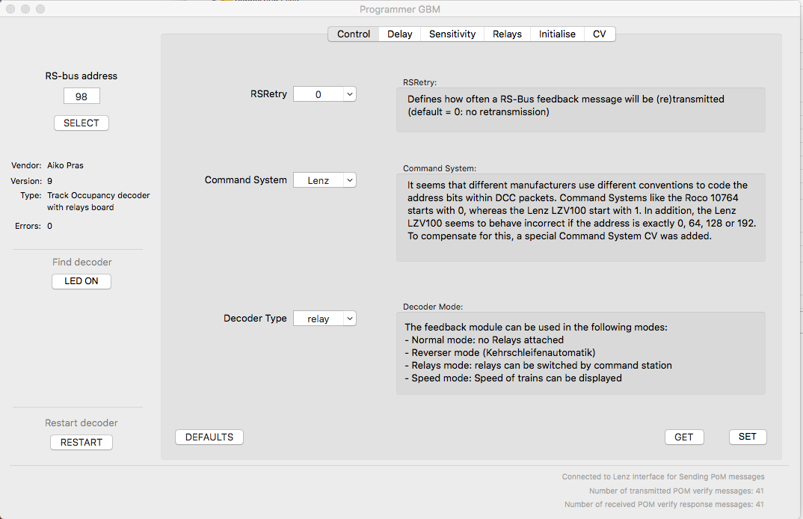

[🇬🇧 English](README.md) | [🇩🇪 Deutsch](README.de.md) | [🇳🇱 Nederlands](README.nl.md)

# Programmer-GBM-POM
Software to configure the track occupancy (feedback) decoder with RS-Bus feedback: the Gleis Besetz Meldung (GBM).

This program allows the initialisation (by reading and modifying CV variables) of the [occupancy detection (feedback) / Gleis Besetz Meldung decoder](https://github.com/aikopras/OPENDECODER22GBM). This decoder sends feedback messages via the RS-Bus and can, for initialisation purposes but also to switch relays, listen to DCC commands. Given that the decoder uses RS-Bus messages for feedback, it will primarily be interesting in environments with LENZ Master stations (like the LZV 100) connected via a LAN/USB interface (such as the 23151).

## Getting the value of CVs ##
To initialise and modify the decoder's Configuration Variables (CVs) the program sends Programming on the Main (PoM) messages. Since the XpressNet specification supports PoM messages only for train decoders (but not for accessory / feedback decoders), the "trick" the decoder uses is to listen to the loco address equal to the <I>RS-Bus address + 6000</I>. The requested CV values are sent back via the RS-Bus: by newer decoders using address 128, by older decoders using their own RS-Bus address. Since newer decoders share address 128 for PoM feedback messages, decoders must be configured one by one.

The program communicates with the LENZ Master station via the LAN/USB interface (23151). If different master stations are used for DCC commands and RS-Bus feedback messages, two LAN/USB interfaces may be used.

## Startup screen ##
The program starts with a screen to enter the RS-Bus address, and shows some basic information regarding this decoder. The various program tabs are further explained in the [Manual](Manual/Manual.md).

## Download ##
| Version | Runs on | Program and installation | Source code and building |
|---|---|---|---|
| macOS | macOS 12 or later, Apple silicon and Intel | [Compiled-Applications/macOS](Compiled-Applications/macOS/README.md) | [src/Xcode](src/Xcode/README.md) (Objective-C) |
| Windows | Windows 10 / 11 (64 bit), Intel / AMD and ARM | [Compiled-Applications/Windows](Compiled-Applications/Windows/README.md) | [src/Qt](src/Qt/README.md) (C++ / Qt 6) |
| Linux | x86_64 | [Compiled-Applications/Linux](Compiled-Applications/Linux/README.md) | [src/Qt](src/Qt/README.md) (C++ / Qt 6) |

The changes per version are described in the [Version history](Version_History.md).
