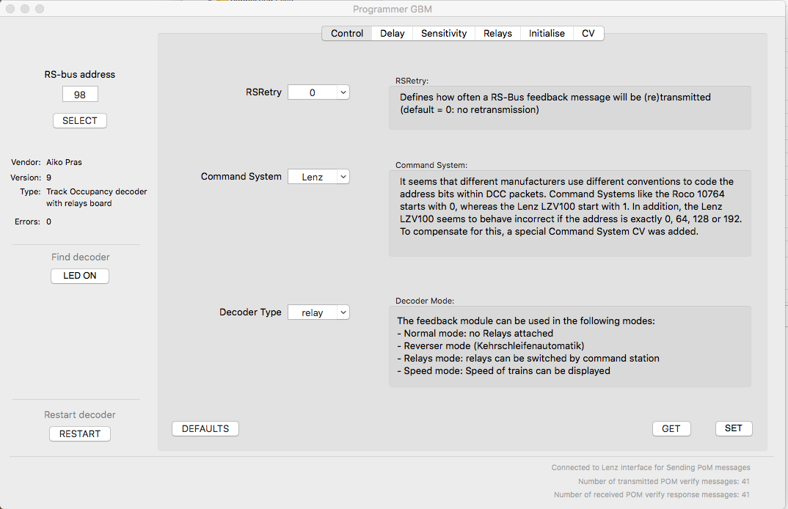

[🇬🇧 English](README.md) | [🇩🇪 Deutsch](README.de.md) | [🇳🇱 Nederlands](README.nl.md)

# Programmer-GBM-POM
Software om de bezetmelder (terugmelddecoder) met RS-Bus-terugmelding in te stellen: de Gleis Besetz Meldung (GBM).

Met dit programma kan de [bezetmelder (terugmelddecoder) / Gleis Besetz Meldung](https://github.com/aikopras/OPENDECODER22GBM) ingesteld worden, door zijn CV's te lezen en te wijzigen. Deze decoder stuurt terugmeldingen via de RS-Bus en kan, om hem in te stellen maar ook om relais te schakelen, naar DCC-commando's luisteren. Omdat de decoder de RS-Bus voor de terugmelding gebruikt, is hij vooral interessant voor banen met LENZ-centrales (zoals de LZV 100) die via een LAN/USB-interface (zoals de 23151) zijn aangesloten.

## CV-waarden uitlezen ##
Om de CV's van de decoder in te stellen en te wijzigen, stuurt het programma PoM-berichten (Programming on the Main). Omdat de XpressNet-specificatie PoM-berichten alleen voor locdecoders kent (niet voor accessory- of terugmelddecoders), luistert de decoder als "truc" naar het locadres <I>RS-Bus-adres + 6000</I>. De gevraagde CV-waarden worden via de RS-Bus teruggemeld: door nieuwere decoders met adres 128, door oudere decoders met hun eigen RS-Bus-adres. Omdat nieuwere decoders adres 128 delen voor hun PoM-terugmeldingen, moeten de decoders één voor één worden ingesteld.

Het programma communiceert met de LENZ-centrale via de LAN/USB-interface (23151). Worden voor DCC-commando's en RS-Bus-terugmeldingen verschillende centrales gebruikt, dan kunnen twee LAN/USB-interfaces worden gebruikt.

## Startscherm ##
Het programma start met een scherm waarin het RS-Bus-adres wordt ingevoerd en enkele gegevens van deze decoder worden getoond. De tabs van het programma worden verder uitgelegd in de [handleiding](Manual/Manual.nl.md).

## Download ##
| Versie | Draait op | Programma en installatie | Broncode en bouwen |
|---|---|---|---|
| macOS | macOS 12 of nieuwer, Apple silicon en Intel | [Compiled-Applications/macOS](Compiled-Applications/macOS/README.md) | [src/Xcode](src/Xcode/README.md) (Objective-C) |
| Windows | Windows 10 / 11 (64 bit), Intel / AMD en ARM | [Compiled-Applications/Windows](Compiled-Applications/Windows/README.md) | [src/Qt](src/Qt/README.md) (C++ / Qt 6) |
| Linux | x86_64 | [Compiled-Applications/Linux](Compiled-Applications/Linux/README.md) | [src/Qt](src/Qt/README.md) (C++ / Qt 6) |

De wijzigingen per versie staan in de [Version history](Version_History.md) (Engels).
